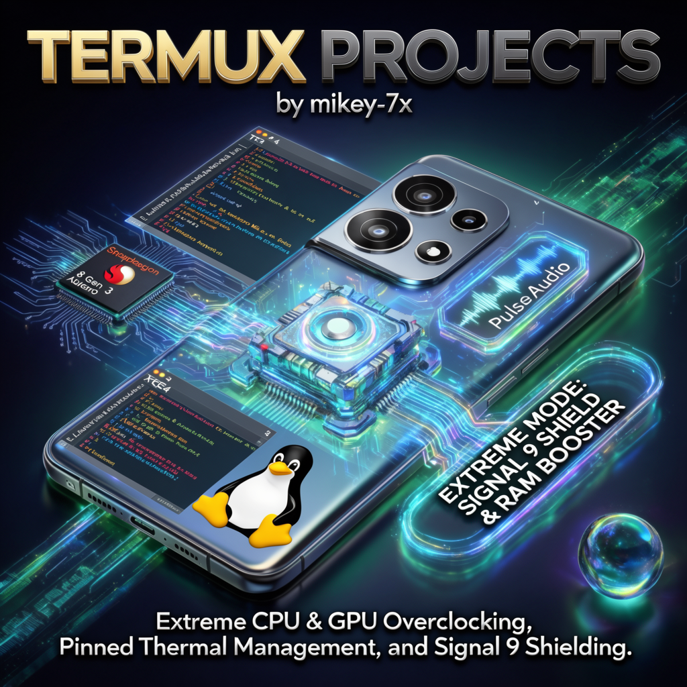

# 🐧 Termux Projects

<p align="center">
  
</p>

> A collection of practical, field-tested Termux utilities for Android — full desktop
> environments with working audio, Android↔Linux storage bridging, safe process
> control, a device-level **Extreme Mode (Safe Freezer Edition)** that hands Termux &
> Termux-X11 every permission Android allows without root, and an **Ultra RAM & ROM
> Optimization Suite** verified on the OnePlus 13R (`CPH2691`).

[](LICENSE)
[]()
[]()
[-orange.svg)]()

**Maintainer:** [mikey-7x](https://github.com/mikey-7x) ·
**Repository:** [mikey-7x/Termux-projects](https://github.com/mikey-7x/Termux-projects)

---

## 📑 Contents

| # | Section | What it does |
|---|---------|--------------|
| 1 | [Project 1 — XFCE4 desktop](#-project-1) | Any Linux distro (udroid/proot) with XFCE4 GUI **and working sound** in Termux-X11 |
| 2 | [Project 2 — Storage bridge](#-project-2) | Full Android internal storage access from inside any distro |
| 3 | [Process kill utilities](#-process-kill-utilities) | Safe/hard ways to kill all proot processes without breaking Termux |
| 4 | [Termux Extreme Mode (Safe Freezer Edition)](#-termux-extreme-mode--signal-9--phantom-process-fix) | Disables PPK, keeps kernel freezer active for background RAM hogs, exempts Termux from Doze, and grants every non-root permission (`extreme_mode_safe.sh`) |
| 5 | [Ultra RAM Booster (`xs7_ramclear.sh`)](#-ultra-ram-booster--app-cache-purge-xs7_ramclearsh) | Frees up to **6.36+ GB RAM** for heavy Linux/Wine/Box64 gaming (`xs-7` & `alfa5`) while preserving Termux & Termux:X11 |
| 6 | [100% Safe System Debloater (`debloat_13r_safe.sh`)](#%EF%B8%8F-100-safe-oneplus-13r--oxygenos-system-debloater-debloat_13r_safesh) | Strips `/data` Play Store updates & disables 31+ safe system bloatware/telemetry daemons with zero misbehavior |
| 7 | [Deep Termux & Arch PRoot ROM Cleaner (`rom_cleaner_termux.sh`)](#-deep-termux--arch-linux-proot-rom-cleaner-rom_cleaner_termuxsh) | Reclaims 15–40+ GB of hidden caches, `.backup-*` Wine prefixes, and staging archives safely |
| 8 | [Arch Linux mirrors](#-working-arch-linux-mirrors-in-termux) | Working pacman mirrorlist for proot Arch |
| 9 | [Project 3 — Void Linux desktop](#-project-3) | Ultra-light Void + XFCE + Falkon + audio |
| 10 | [License & credits](#-license--credits) | MIT |

---

## 📂 Complete Repository Script Index

| Script File | Where to Run | Purpose |
|-------------|--------------|---------|
| `p1.sh` | Termux | Launch XFCE4 desktop + PulseAudio TCP sound (UDroid / Kali NetHunter / generic distro) |
| `pd.sh` / `pd2.sh` / `pd3.sh` | Termux | Launch `proot-distro` Ubuntu XFCE4 desktop in Termux-X11 with hardware sound |
| `pd2sd.sh` | Termux | Launch `proot-distro` XFCE4 desktop with external SD card bind-mounted |
| `vd.sh` | Termux | Launch Void Linux XFCE4 desktop with AAudio PulseAudio loopback & X11 |
| `killp.sh` | Termux | Interactive safe process terminator for all Termux-owned background processes |
| `ukill.sh` / `killu.sh` | Inside PRoot Distro | Safe (`ukill.sh`) and hard (`killu.sh`) PRoot background process terminators |
| `extreme_mode_safe.sh` | aShell (Shizuku) / ADB | **Automated Extreme Mode & Freezer Recovery**: Disables Phantom Process Killer, enables kernel cached-app freezer (`use_freezer true`), whitelists Termux from Doze, and grants all AppOps permissions |
| `xs7_ramclear.sh` | aShell (Shizuku) / ADB | **Ultra RAM & App Cache Purge**: Trims all Android app caches, locks stubborn background apps, and frees **6.0–6.4+ GB RAM** while preserving Termux & Termux:X11 |
| `debloat_13r_safe.sh` | aShell (Shizuku) / ADB | **100% Safe System Debloater**: Strips updates, clears data, and disables 31+ bloatware/AI/telemetry packages without breaking any daily apps |
| `rom_cleaner_termux.sh` | Termux | **Deep Container & Storage Cleaner**: Cleans Termux `apt`, Arch `pacman`, hidden `.backup-*` Wine prefixes, Wine temp files, and Arduino `staging/` archives |

---

## 🔥 Project 1

### Run Any Linux Distribution with XFCE4 in Termux-X11 GUI (with Working Sound)

This project lets you run a full desktop Linux environment (XFCE4) inside Termux on
Android with GUI and working audio using Termux-X11.

---

### Quick One-Liner to Download and Execute

```bash
curl -O https://raw.githubusercontent.com/mikey-7x/Termux-projects/main/p1.sh && chmod +x p1.sh && nano p1.sh
```

After editing the script (see Step 2 below), run:

```bash
./p1.sh
```

---

### Step-by-Step Manual Setup

**Step 1 — Install required packages**

*In Termux:*

```bash
termux-setup-storage
pkg update && pkg upgrade -y
pkg install wget -y
pkg install git -y
pkg install tur-repo -y
pkg install x11-repo -y
pkg install termux-x11-nightly -y
pkg install pulseaudio -y
pkg install curl -y
```

*In your Linux distribution (Ubuntu, Kali, etc.):*

```bash
apt update -y
apt upgrade -y
apt install sudo nano adduser -y
```

```bash
adduser your_name
```

then it will ask for a password — type it.

```bash
nano /etc/sudoers
```

then find `root ALL=(ALL:ALL) ALL` and BELOW IT TYPE:

```
YOUR_NAME ALL=(ALL:ALL) ALL
```

Ctrl+X → Y → Enter. Then switch to your user:

```bash
su - your_name
```

Run `whoami` — if it prints your user id, the user was made successfully. Then:

```bash
apt update && apt install -y xfce4 dbus-x11 xfce4-goodies xfce4-terminal x11-xserver-utils
```

> Most of the time `sudo` is not required as root; if needed, simply prefix `sudo`
> before the `apt` command.

> ⚠️ **Known issue:** this command often stops mid-installation on
> `elementary-xfce-icon-theme`. Remove that single package with:
>
> ```bash
> dpkg --remove --force-remove-reinstreq elementary-xfce-icon-theme
> ```

*For Arch Linux:*

```bash
sudo pacman -Syu --noconfirm xfce4 dbus xorg-xhost
```

or

```bash
sudo pacman -Syu --noconfirm
sudo pacman -S --needed xfce4 xfce4-goodies
```

**Step 2 — Prepare Termux**

Run in Termux and remove the `#` from the `#allow-external-apps = true` line in:

```bash
nano ~/.termux/termux.properties
```

**Step 3 — Download the script manually**

```bash
wget https://raw.githubusercontent.com/mikey-7x/Termux-projects/main/p1.sh
```

Edit the script:

```bash
nano p1.sh
```

Replace the following lines:

```
udroid login jammy:xfce4 << 'EOF'
su - yogesh -c 'export
```

**With:**

```
[your_login_command_here] << 'EOF'
su - [your_username_here] -c 'export
```

> To run as root, simply remove the `su - yogesh -c` part from the p1.sh script.

**Step 4 — Make the script executable and run it**

```bash
chmod +x p1.sh
./p1.sh
```

---

### For proot-distro distributions

**Steps 1 & 2 are the same as above.**

**🦞 Install script**

```bash
curl -O https://raw.githubusercontent.com/mikey-7x/Termux-projects/main/pd.sh
```

**OR**

```bash
curl -O https://raw.githubusercontent.com/mikey-7x/Termux-projects/main/pd2.sh
```

**🦞 Open script**

```bash
nano pd.sh
```

**OR**

```bash
nano pd2.sh
```

Replace `ubuntu` with your linux distribution's login id in this line of the script:

```
ubuntu <<'EOL'
```

**For the pd2.sh script:** replace `proot-distro login ubuntu` with your login id,
and replace `ubuntu` with your user id in this line:

```
proot-distro login ubuntu --shared-tmp -- /bin/bash -c  'export PULSE_SERVER=127.0.0.1 && export XDG_RUNTIME_DIR=${TMPDIR} && su - ubuntu -c "env DISPLAY=:0 startxfce4"'
```

```
exit 0
```

**🦞 Give permission**

```bash
chmod +x pd.sh
```

**OR**

```bash
chmod +x pd2.sh
```

**🦞 Execute the script**

```bash
./pd.sh
```

**OR**

```bash
./pd2.sh
```

---

### For Kali-Nethunter (rootless)

All procedures are the same as above (process Steps 1, 2, 3, 4), plus these extra
steps to set up Kali-Nethunter with XFCE4 in the Termux-X11 GUI.

The `p1.sh` script works perfectly with Kali-Nethunter, **with sound**.

**🦞 In Termux run:**

```sh
nano $PREFIX/bin/nh
```

**🦞 Find the `/dev` line and, after this line, add:**

```sh
-b /data/data/com.termux/files/usr/tmp:/tmp \
```

Then press `Ctrl+X` → `Enter`.

**🦞 After everything is done, run Kali-Nethunter with GUI:**

```sh
./p1.sh
```

---

### 💥 New: external SD card access (`pd2sd.sh`)

A new script, **`pd2sd.sh`**, gives your Linux distro access to an external SD card.

Simply copy your SD card path and replace `/storage/67FE-7DD2:` with your path in
this line of the script:

```
--bind /storage/67FE-7DD2:/mnt/sdcard_ext \
```

> **Note:** when editing the script to put your login id, make sure you use the
> **original login command** (e.g. `proot-distro login ubuntu`), not an alias — and
> then add your user id.
>
> In all scripts here, `pd2sd.sh` is designed to work well with proot-distro
> distributions. The first script, `p1.sh`, works directly with an alias or any
> login id.

---

## 🔥 Project 2

### Access internal storage in any Linux distribution in Termux on Android

**Step 1:** Make a shortcut for your login id in Termux:

```bash
nano ~/.bashrc
```

add:

```bash
alias mikey="udroid login jammy:xfce4 su mikey"

# Enable colored prompt
force_color_prompt=yes

if [ -n "$force_color_prompt" ]; then
    if [ -x /usr/bin/tput ] && tput setaf 1 >&/dev/null; then
        PS1='\033[01;32m\u@\h:\w\$ \033[00m'
    else
        PS1='\u@\h:\w\$ '
    fi
fi

if [ ! -d ~/storage ]; then
    mkdir -p ~/storage
    ln -s /storage/emulated/0 ~/storage/shared
    ln -s /storage/emulated/0/Download ~/storage/downloads
    ln -s /storage/emulated/0/DCIM ~/storage/dcim
    ln -s /storage/emulated/0/Movies ~/storage/movies
    ln -s /storage/emulated/0/Music ~/storage/music
    ln -s /storage/emulated/0/Pictures ~/storage/pictures
else
    [ ! -e ~/storage/shared ] && ln -s /storage/emulated/0 ~/storage/shared
    [ ! -e ~/storage/downloads ] && ln -s /storage/emulated/0/Download ~/storage/downloads
    [ ! -e ~/storage/dcim ] && ln -s /storage/emulated/0/DCIM ~/storage/dcim
    [ ! -e ~/storage/movies ] && ln -s /storage/emulated/0/Movies ~/storage/movies
    [ ! -e ~/storage/music ] && ln -s /storage/emulated/0/Music ~/storage/music
    [ ! -e ~/storage/pictures ] && ln -s /storage/emulated/0/Pictures ~/storage/pictures
fi

[ -d /home/mikey ] && cd /home/mikey
```

*For Arch Linux:*

```bash
alias mikey='proot-distro login archlinux --user mikey'
mkdir -p ~/storage

ln -sf /data/data/com.termux/files/home/storage/shared    ~/storage/shared
ln -sf /data/data/com.termux/files/home/storage/downloads ~/storage/downloads
ln -sf /data/data/com.termux/files/home/storage/dcim      ~/storage/dcim
ln -sf /data/data/com.termux/files/home/storage/music     ~/storage/music
ln -sf /data/data/com.termux/files/home/storage/movies    ~/storage/movies
ln -sf /data/data/com.termux/files/home/storage/pictures  ~/storage/pictures
```

**Edit:**

1. In the first line
   (`alias mikey="udroid login jammy:xfce4 su mikey"` /
   `alias mikey='proot-distro login archlinux --user mikey'`):

   - 🔗 the word `mikey` after `alias` is the shortcut you type to log in — change
     it to whatever you like.
   - 🔗 replace `udroid login jammy:xfce4` or `proot-distro login archlinux` with
     your root login command.
   - 🔗 replace `mikey` in `su mikey` or `--user mikey` with your user login id.

2. In the last line (`cd /home/mikey`):
   - 🔗 replace `/home/mikey` with your default path for your user login id.

**Step 2:** press `Ctrl+X` → `Y` → `Enter`

**Step 3:** run this in Termux:

```bash
source ~/.bashrc
```

**Step 4:** run your distribution by typing the alias (from step 1) in Termux —
in my case it is:

```bash
mikey
```

**Step 5:** create the accessible storage links:

```bash
mkdir -p ~/storage

ln -sf /data/data/com.termux/files/home/storage/shared    ~/storage/shared
ln -sf /data/data/com.termux/files/home/storage/downloads ~/storage/downloads
ln -sf /data/data/com.termux/files/home/storage/dcim      ~/storage/dcim
ln -sf /data/data/com.termux/files/home/storage/music     ~/storage/music
ln -sf /data/data/com.termux/files/home/storage/movies    ~/storage/movies
ln -sf /data/data/com.termux/files/home/storage/pictures  ~/storage/pictures
```

For an even simpler setup:

```bash
rm -rf ~/storage  # remove the whole folder safely
ln -sf /data/data/com.termux/files/home/storage/shared ~/storage
```

**Now you can access all of Android's internal storage from inside your Linux
distribution in Termux.**

> **Note:** you can choose any alias for logging in — I use the same name as my
> login id (`mikey` in my case).

---

## 🔥 Process kill utilities

### Kill all Termux processes safely (no harm to other packages/files)

```bash
wget https://raw.githubusercontent.com/mikey-7x/Termux-projects/refs/heads/main/killp.sh
```

### Kill processes running inside Ubuntu

*safe:*

```bash
wget https://raw.githubusercontent.com/mikey-7x/Termux-projects/refs/heads/main/ukill.sh
```

*hard:*

```bash
wget https://raw.githubusercontent.com/mikey-7x/Termux-projects/refs/heads/main/killu.sh
```

---

## 🔥 Termux Extreme Mode — Signal 9 & Phantom Process Fix

If you run heavy Linux environments through Termux (Ubuntu, Arch, Void, Wine/Box64 `xs-7`, `alfa5` XFCE4, …) with
Termux-X11, Android 12+ will often kill your session abruptly:

```
[Process completed (signal 9) - press Enter]
```

That is caused by four independent Android mechanisms working against you:

| Mechanism | What it does & How Safe Extreme Mode handles it |
|-----------|-------------------------------------------------|
| **Phantom Process Killer (PPK)** | Android 12+ limits background child processes (default cap: 32) and kills the excess — this is the #1 cause of Signal 9 for proot. **Fix:** Disabled persistently (`max_phantom_processes = 2147483647`). |
| **Cached-apps freezer** | A kernel cgroup-v2 freezer that suspends cached background apps. **Important Architectural Fix:** Keep `use_freezer` set to **`true`** (`enabled`) globally so background RAM hogs (Facebook, Instagram, Telegram, WhatsApp, Opera) freeze at `0%` CPU, while exempting **Termux / Termux:X11 / Termux:API** via Doze Whitelist + `RUN_ANY_IN_BACKGROUND allow` + `termux-wake-lock`! |
| **Doze / Device Idle** | The battery manager throttles background work and network. **Fix:** Whitelist `com.termux`, `com.termux.x11`, and `com.termux.api`. |
| **OOM killer (LMK)** | When RAM is tight the kernel kills the largest consumer. **Fix:** Pair with `xs7_ramclear.sh` to free **6.0–6.4+ GB RAM** before launching heavy desktops or Windows games. |

> ### 🧠 Why `use_freezer` Must Be `true` (Enabled) Instead of `false`
> Earlier revisions set `/system/bin/device_config put activity_manager_native_boot use_freezer false` (which flips **Developer Options → "Suspend execution for cached apps"** to **Disabled**).
> - **The Problem with `use_freezer false`:** It disables the kernel cgroup freezer **globally for every app on the phone**. Even if you Force Stop or restrict background activity for Facebook, Instagram, Telegram, Google Drive, or WhatsApp, Google Play Services push intents wake them back up—and because the global freezer is off, they remain unfrozen in RAM indefinitely, consuming **2.5 GB – 3.5 GB of RAM**!
> - **Why `use_freezer true` is 100% Safe for Termux & Termux-X11:** Android's cached-app freezer (`oom_score_adj >= 900`) **never** freezes the foreground `TOP` app on screen (`com.termux.x11`) or any app holding a Foreground Service / WakeLock (`termux-wake-lock` in `com.termux`) with `RUN_ANY_IN_BACKGROUND: allow` and Doze Whitelist exemption.
> - **Result:** Setting `use_freezer true` freezes all unrelated Android apps in the background while Termux, PRoot, XFCE4, Box64, and Wine run at 100% full speed!

### 📱 Tested configuration

| | |
|---|---|
| **Device** | OnePlus 13R (CPH2691) |
| **OS** | OxygenOS 15 / 16 (Android 14/15 kernel) |
| **Hardware** | Snapdragon 8 Gen 3 (Adreno 750), 12 GB LPDDR5X RAM, 256 GB UFS 4.0 ROM |

---

### 🛠️ Prerequisites

Two apps are needed to run ADB-level commands **on the device, without a PC**:

1. **Shizuku** — the bridge that grants ADB-level privileges to on-device apps.
   [Google Play](https://play.google.com/store/apps/details?id=moe.shizuku.privileged.api)
2. **aShell** — a local ADB shell driven by Shizuku.
   [F-Droid](https://f-droid.org/packages/in.sunilpaulmathew.ashell/)

> Reference: [saicharankandukuri — Termux Signal 9 fix](https://saicharankandukuri.github.io/posts/termux-signal9-fix/)

---

### 🚀 Step 1 — Pair and start Shizuku

1. **Enable Developer Options:** Settings → About device → Version → tap
   **Build number** 7 times until it says "You are now a developer."
2. **Enable Wireless debugging:** Settings → System & update → Developer options →
   toggle **Wireless debugging** on (stay connected to Wi-Fi).
3. **Pair Shizuku:** open the **Shizuku** app → "Start via Wireless debugging" →
   **Pairing** → open Developer options → **Wireless debugging** (tap the text, not
   the toggle) → **Pair device with pairing code** → enter the 6-digit code into
   the Shizuku notification.
4. **Start the service:** back in **Shizuku** → **Start**. Then tap
   **Authorised Application** and enable the permission for **aShell**.

---

### ⚡ Quick Automated Setup (Recommended One-Script Method)

Instead of pasting commands one by one, you can download `extreme_mode_safe.sh` to `/storage/emulated/0/` in **Termux** and run it with a single command in **aShell**:

**1. Run in Termux:**
```bash
curl -sL https://raw.githubusercontent.com/mikey-7x/Termux-projects/main/extreme_mode_safe.sh -o /storage/emulated/0/extreme_mode_safe.sh && chmod +x /storage/emulated/0/extreme_mode_safe.sh
```

**2. Run in aShell (Shizuku):**
```bash
sh /storage/emulated/0/extreme_mode_safe.sh
```

---

### 💻 Step 2 — Manual Single-Line Commands in aShell

Open **aShell** → grant Shizuku access → **Allow all the time**.

> ⚠️ **aShell's command box executes ONE line at a time.** Multi-line pastes break
> with `sh: syntax error: unmatched 'for'`. Every command and every verification
> below is therefore its own **single-line block**: paste one line → Enter → wait for
> the `shell@CPH2691#` prompt → next line.
>
> If you use a PC instead, prefix **every** command with `adb shell `.

All commands in Blocks 1–4 are **system-level settings writes** — once executed, they are stored
by Android and **stay active across reboots** (see the
[persistence matrix](#-persistence--what-survives-and-what-doesnt)).

---

#### Block 1 — Disable Phantom Process Killer & Enable Kernel Cached-Apps Freezer *(persistent)*

This removes the 32-child-process ceiling for Termux while ensuring Android's cached-app
freezer stays **enabled (`true`)** to freeze background RAM-hogging apps (Facebook, Instagram, WhatsApp, etc.).

**Command 1.1** — stop device_config re-syncing to defaults (makes the PPK value sticky across reboots):

```
/system/bin/device_config set_sync_disabled_for_tests persistent
```

**Command 1.2** — remove the phantom-process ceiling:

```
/system/bin/device_config put activity_manager max_phantom_processes 2147483647
```

**Verification 1.2:**

```
device_config get activity_manager max_phantom_processes
```

Expected output: `2147483647`

**Command 1.3a** — keep the kernel cached-apps freezer **enabled (`true`)** so background Android apps do not drain RAM:

```
/system/bin/device_config put activity_manager_native_boot use_freezer true
```

**Command 1.3b** — ensure the global cached-apps freezer setting is enabled:

```
settings put global cached_apps_freezer enabled
```

**Verification 1.3:**

```
device_config get activity_manager_native_boot use_freezer
```

Expected output: `true` *(Note: Reboot your phone once if changing from `false` to `true`)*.

**Command 1.4** — mirror the PPK value into the Settings provider:

```
settings put global max_phantom_processes 2147483647
```

**Verification 1.4:**

```
settings get global max_phantom_processes
```

Expected output: `2147483647`

---

#### Block 2 — Keep Developer Options & ADB permanently on *(persistent)*

These persist and keep the "door open" — so the debugging channel your tooling
relies on stays reachable even if someone toggles Developer Options off.

**Command 2.1**

```
settings put global developer_options 1
```

**Verification 2.1:**

```
settings get global developer_options
```

Expected output: `1`

**Command 2.2**

```
settings put global adb_enabled 1
```

**Verification 2.2:**

```
settings get global adb_enabled
```

Expected output: `1`

---

#### Block 3 — Remove the Termux ecosystem from Doze / battery throttling *(persistent)*

Prevents the battery manager and cached-apps freezer from putting Termux apps to sleep or throttling them
while running.

**Command 3.1**

```
dumpsys deviceidle whitelist +com.termux
```

**Command 3.2**

```
dumpsys deviceidle whitelist +com.termux.x11
```

**Command 3.3**

```
dumpsys deviceidle whitelist +com.termux.api
```

> ⚠️ **Why there is no `appops … IGNORE_BATTERY_OPTIMIZATIONS` command here.**
> On OxygenOS 15/16 (Android 14/15) that string is **not an operation in the appops
> table** — the command fails with
> `Error: Unknown operation string: IGNORE_BATTERY_OPTIMIZATIONS` (reproduced on
> the tested phone). The **working** command for "ignore battery optimizations"
> is the Doze whitelist — `dumpsys deviceidle whitelist +<package>` — which is
> exactly what the Settings *Ignore battery optimizations* toggle writes under
> the hood. That is what Commands 3.1–3.3 above do, so the battery exemption is
> complete with no further command needed.

**Verification 3a** — clean, single-line check that all three packages are whitelisted:

```
dumpsys deviceidle whitelist | grep termux
```

Expected output (tested device — 3 lines; UID numbers are per-device, the point is all three packages are listed):

```
user,com.termux,10763  ·  user,com.termux.x11,10764  ·  user,com.termux.api,10763
```

**Verification 3b** — confirm none of the Termux packages are on the *un*-whitelist:

```
dumpsys deviceidle unwhitelisted | grep termux
```

Expected output: **nothing at all** (no output = all three are properly
whitelisted).

---

#### Block 4 — Full permission grant for the Termux ecosystem *(persistent)*

Every permission that a **non-root** ADB session can grant, applied to every
**installed** Termux package. On the tested phone (CPH2691) that is exactly
three — `com.termux`, `com.termux.x11`, `com.termux.api`.

> ⚠️ **Scope:** Termux:GUI is not installed on the tested phone, so **this guide
> contains no commands for it** — every command below targets only the three
> installed packages (see Verification 4.0). Commands that name an uninstalled
> package fail with `Error: No UID for <pkg> in user 0`; that is about the
> missing app, never about the other packages (`appops` is silent on success).

Each line below is a complete ONE-line command:

| Permission | Effect |
|------------|--------|
| `RUN_IN_BACKGROUND` | Allows background execution without system restriction |
| `RUN_ANY_IN_BACKGROUND` | Unrestricted background execution even under strict battery savers |
| `WAKE_LOCK` | Allows `termux-wake-lock` to hold CPU awake and prevent freezer suspension |
| `SYSTEM_ALERT_WINDOW` | "Display over other apps" — Termux-X11 renders correctly over Android |
| `MANAGE_EXTERNAL_STORAGE` | "All files access" — no scoped-storage interference |
| *Battery exemption* | Handled by Block 3 (Doze whitelist) — the appops op string does not exist on OxygenOS 16 |

**Verification 4.0 — run FIRST** — see exactly which Termux packages exist on this phone:

```
pm list packages | grep termux
```

Expected on the tested device (exactly 3 lines):

```
package:com.termux  ·  package:com.termux.api  ·  package:com.termux.x11
```

**Command 4.1**

```
for pkg in com.termux com.termux.x11 com.termux.api; do appops set $pkg RUN_IN_BACKGROUND allow; appops set $pkg RUN_ANY_IN_BACKGROUND allow; appops set $pkg WAKE_LOCK allow; done
```

**Command 4.2**

```
for pkg in com.termux com.termux.x11 com.termux.api; do appops set $pkg SYSTEM_ALERT_WINDOW allow; done
```

**Command 4.3**

```
for pkg in com.termux com.termux.x11 com.termux.api; do appops set $pkg MANAGE_EXTERNAL_STORAGE allow; done
```

**Command 4.4**

```
appops set --user 0 com.termux SYSTEM_ALERT_WINDOW allow
```

**Command 4.5**

```
appops set --user 0 com.termux.x11 SYSTEM_ALERT_WINDOW allow
```

**Verification 4.1 — main Termux app** — all operations must show `allow`:

```
appops get com.termux | grep -E 'RUN_IN_BACKGROUND|RUN_ANY_IN_BACKGROUND|WAKE_LOCK|SYSTEM_ALERT_WINDOW|MANAGE_EXTERNAL_STORAGE'
```

Expected (a `; time=…` / `; rejectTime=…` suffix on any line is normal):

```
RUN_IN_BACKGROUND: allow  ·  RUN_ANY_IN_BACKGROUND: allow  ·  WAKE_LOCK: allow  ·  SYSTEM_ALERT_WINDOW: allow  ·  MANAGE_EXTERNAL_STORAGE: allow
```

**Verification 4.2 — Termux:X11 background operation** — the important required
result is `RUN_ANY_IN_BACKGROUND: allow`:

```
appops get com.termux.x11 | grep -E 'RUN_ANY_IN_BACKGROUND|SYSTEM_ALERT_WINDOW|MANAGE_EXTERNAL_STORAGE'
```

Expected on the tested CPH2691 build:

```
RUN_ANY_IN_BACKGROUND: allow  ·  SYSTEM_ALERT_WINDOW: default  ·  MANAGE_EXTERNAL_STORAGE: default
```

`default` for `SYSTEM_ALERT_WINDOW` and `MANAGE_EXTERNAL_STORAGE` on
`com.termux.x11` is not an error and is normal when that X11 build does not
request or use those operations. They are not required for xs-7 file access;
file access is provided by the main `com.termux` app. The Doze whitelist and
`RUN_ANY_IN_BACKGROUND: allow` are the important X11 checks. A `; time=…` or
`; rejectTime=…` suffix is normal metadata.

**Optional — notification runtime permission (only if your build declares it):**

**Command 4.6 (optional)**

```
pm grant com.termux android.permission.POST_NOTIFICATIONS
```

**Command 4.7 (optional)**

```
pm grant com.termux.x11 android.permission.POST_NOTIFICATIONS
```

**Command 4.8 (optional)**

```
pm grant com.termux.api android.permission.POST_NOTIFICATIONS
```

> If any of these throws `java.lang.IllegalArgumentException: Unknown permission`,
> that build of the app does **not** declare `POST_NOTIFICATIONS` — the permission
> is not grantable on it. **This is harmless: skip it.** Notifications don't affect
> stability or gaming. Check whether a build declares it at all:
>
> ```
> dumpsys package com.termux | grep -i post_notifications
> ```
>
> (empty output = not declared = skip the pm grant lines)

**Storage inside Termux** — the user-side counterpart of `MANAGE_EXTERNAL_STORAGE`.
Run inside **Termux** (not aShell):

```
termux-setup-storage
```

> ⚠️ **Honest limit (no root):** permissions marked *signature* or *privileged*
> (`WRITE_SECURE_SETTINGS`, `DUMP`, `READ_LOGS`, …) **cannot** be granted by any
> non-root tool — a plain `pm grant` for them can only fail. The set above is the
> **complete grantable set**.

---

#### Block 5 — Temporary session hints *(NOT persistent — by design)*

These act as hints for the currently active session only and are **not** stored.
Run them whenever you want an extra nudge (harmless, but they do not survive a
reboot or an app restart):

**Command 5.1**

```
am set-inactive com.termux false
```

**Command 5.2**

```
am set-inactive com.termux.x11 false
```

---

### ✅ Final verification — run these ONE BY ONE in aShell

Once all blocks are run, verify the complete state:

**Check 1**

```
device_config get activity_manager max_phantom_processes
```

Expected: `2147483647`

**Check 2**

```
device_config get activity_manager_native_boot use_freezer
```

Expected: `true`

**Check 3**

```
settings get global max_phantom_processes
```

Expected: `2147483647`

**Check 4**

```
settings get global developer_options
```

Expected: `1`

**Check 5**

```
settings get global adb_enabled
```

Expected: `1`

**Check 6**

```
dumpsys deviceidle whitelist | grep termux
```

Expected: 3 lines for `com.termux`, `com.termux.x11`, `com.termux.api`

**Check 7**

```
appops get com.termux | grep -E 'RUN_ANY_IN_BACKGROUND|SYSTEM_ALERT_WINDOW|MANAGE_EXTERNAL_STORAGE'
```

Expected: the three `allow` lines (RUN_ANY_IN_BACKGROUND, SYSTEM_ALERT_WINDOW, MANAGE_EXTERNAL_STORAGE)

**Check 8 — Termux:X11 background operation**

```
appops get com.termux.x11 | grep RUN_ANY_IN_BACKGROUND
```

Expected: `RUN_ANY_IN_BACKGROUND: allow`.

Once **all 8 checks pass**, you can launch Termux, boot your Linux container, and
fire up Termux-X11 without worrying about random Signal 9 kills or background Android apps draining your RAM!

---

### 🧲 Persistence — what survives, and what doesn't

Everything written in Blocks 1–4 is stored by Android itself under
`/data/system` (device_config protobuf, Settings provider database,
`app-ops.xml`, device-idle whitelist). Consequences:

| Setting | Survives reboot | Survives turning Developer Options off | Survives app update |
|---------|:---:|:---:|:---:|
| `device_config put` (with sync disabled) | ✅ | ✅ | ✅ |
| `settings put global …` | ✅ | ✅ | ✅ |
| `appops set … allow` | ✅ | ✅ | ✅ |
| `dumpsys deviceidle whitelist …` | ✅ | ✅ | ✅ |
| `am set-inactive` (Block 5) | ❌ temporary | ❌ | ❌ |

**Why turning Developer Options off changes nothing:** Developer Options only
control the *channel* used to deliver the commands (USB/wireless debugging). The
settings themselves live in system storage and are not tied to that channel at all.
`settings put global developer_options 1` (Block 2) additionally keeps the menu
itself from being hidden again.

**The two real reset vectors:**

1. **Major OxygenOS/Android system update** — some updates re-apply AOSP
   device_config defaults. Fix: re-run `sh /storage/emulated/0/extreme_mode_safe.sh` (takes 5 seconds).
2. **Wireless-debugging pairing timeout** — Shizuku's wireless pairing idles out
   after a few hours. That only affects *running new* commands; every setting above
   keeps working the whole time. Re-pair via the Shizuku app when needed.

---

### 🧹 Removed / Corrected from Previous Revisions (Safety Review)

| Modified / Removed Command | Why It Was Changed or Removed |
|----------------------------|-------------------------------|
| `device_config put activity_manager_native_boot use_freezer false` → **Changed to `true`** | Setting `use_freezer false` globally disabled the kernel cached-app freezer for **all** Android apps, allowing Facebook, Instagram, Telegram, WhatsApp, and Opera to run unfrozen in the background and consume 3+ GB of RAM. Setting `use_freezer true` freezes background apps while Termux (`termux-wake-lock` + Doze whitelist + `RUN_ANY_IN_BACKGROUND allow`) stays 100% exempt. |
| `settings delete global activity_manager_constants` | Deletes a live system-settings entry. No PPK benefit; unknown side effects on framework behavior. |
| `settings put global settings_enable_monitor_phantom_procs false` | Not a real framework setting — it only wrote a dead key. |
| `pm grant … android.permission.WRITE_SECURE_SETTINGS` | *signature* permission — impossible without root; the command can only error. |
| `pm grant … android.permission.DUMP` | *signature* permission — same as above. |
| `pm grant … android.permission.READ_LOGS` | *signature* permission — same as above. |
| `pm grant … android.permission.PACKAGE_USAGE_STATS` | Not a runtime permission — granted only via *Settings → Special app access → Usage access*, if ever needed. |
| Legacy `pm grant … READ/WRITE_EXTERNAL_STORAGE` | Max-Sdk-capped on recent builds; replaced by `termux-setup-storage` + the `MANAGE_EXTERNAL_STORAGE` appop (Block 4). |

---

## ⚡ Ultra RAM Booster & App Cache Purge (`xs7_ramclear.sh`)

When running heavy desktop architectures (`alfa5.sh` XFCE4) and Windows game translation pipelines (`xs-7.sh` with Box64, Wine/Proton, DXVK, and Turnip Adreno drivers), games require **4.5 GB – 6.0+ GB of `MemAvailable`**.

Standard Recents cleaners (`dumpsys activity recents`) fail because apps like **Facebook, Instagram, Telegram, WhatsApp, Opera, and Google Drive** run headless background services that do not appear in Recents—and Google Play Services (`GMS`) wakes them back up seconds after a normal `am force-stop`.

### What `xs7_ramclear.sh` Does:
1. **Purges 100% of Android App Caches (`pm trim-caches 999G`)**: Frees gigabytes of internal app caches in 0.5 seconds without needing Accessibility-based cache cleaners (such as AppMgr III).
2. **Disables Hidden AI & Telemetry Daemons**: Stops `com.google.android.aicore` (which wires **1.2–1.5 GB RAM** on Snapdragon 8 Gen 3), Meta background daemons, and OPlus/HeyTap telemetry services.
3. **Locks & Stops All 3rd-Party Background Apps**: Sets `RUN_IN_BACKGROUND ignore`, `RUN_ANY_IN_BACKGROUND ignore`, and `WAKE_LOCK ignore` before calling `am force-stop`, while **strictly preserving `com.termux`, `com.termux.x11`, `com.termux.api`, `aShell`, and `Shizuku`**.
4. **Evicts Cached Processes & Trims SystemUI/Launcher GPU Memory**: Calls `am kill-all` and `am send-trim-memory` to release unified Adreno GPU/system RAM.

### How to Deploy & Run `xs7_ramclear.sh`

**Step 1 — Generate `/storage/emulated/0/xs7-ramclear.sh` in Termux (Semicolon-Protected, Paste-Safe):**

```bash
cat << 'EOF' > /storage/emulated/0/xs7-ramclear.sh
echo "== [1/4] PURGING ALL ANDROID APP CACHES ==";
pm trim-caches 999999999999999999 >/dev/null 2>&1;
cmd package trim-caches 999999999999999999 internal >/dev/null 2>&1;
rm -rf /storage/emulated/0/Android/data/*/cache/* 2>/dev/null;
rm -rf /storage/emulated/0/Android/data/*/code_cache/* 2>/dev/null;
rm -rf /data/local/tmp/* 2>/dev/null;
echo "== [2/4] DISABLING AI, META & OPLUS TELEMETRY DAEMONS ==";
for sys_pkg in com.google.android.aicore com.facebook.services com.facebook.system com.facebook.appmanager com.heytap.cloud com.heytap.mcs com.heytap.accessory com.heytap.habit.analysis com.oplus.stdid com.oplus.logkit com.oplus.crashbox com.oplus.statistics.rom com.oplus.lfeh com.coloros.activation; do pm disable-user --user 0 "$sys_pkg" >/dev/null 2>&1; am force-stop "$sys_pkg" >/dev/null 2>&1; done;
echo "== [3/4] PROTECTING WHATSAPP & GEMINI NOTIFICATIONS, STOPPING OTHER APPS ==";
for keep_pkg in com.whatsapp com.whatsapp.w4b com.google.android.apps.bard com.google.android.googlequicksearchbox com.google.android.gm org.telegram.messenger; do cmd appops set "$keep_pkg" RUN_IN_BACKGROUND allow >/dev/null 2>&1; cmd appops set "$keep_pkg" RUN_ANY_IN_BACKGROUND allow >/dev/null 2>&1; cmd appops set "$keep_pkg" WAKE_LOCK allow >/dev/null 2>&1; done;
for pkg in $(pm list packages -3 2>/dev/null | cut -d: -f2); do case "$pkg" in com.termux*|in.sunilpaulmathew.ashell*|moe.shizuku.privileged.api*|com.whatsapp*|com.google.android.apps.bard*) continue ;; esac; am force-stop "$pkg" >/dev/null 2>&1; done;
for gpkg in com.google.android.youtube com.google.android.apps.photos com.google.android.apps.maps com.google.android.apps.docs com.android.chrome com.google.android.videos com.google.android.music; do am force-stop "$gpkg" >/dev/null 2>&1; done;
/system/bin/device_config set_sync_disabled_for_tests persistent >/dev/null 2>&1;
/system/bin/device_config put activity_manager max_phantom_processes 2147483647 >/dev/null 2>&1;
settings put global max_phantom_processes 2147483647 >/dev/null 2>&1;
echo "== [4/4] EVICTING CACHED PROCESSES & GPU BUFFERS ==";
am kill-all >/dev/null 2>&1;
am send-trim-memory com.android.systemui RUNNING_CRITICAL >/dev/null 2>&1;
am send-trim-memory com.android.launcher COMPLETE >/dev/null 2>&1;
echo "== FREE RAM AFTER ULTRA PURGE ==";
grep -E '^(MemTotal|MemFree|MemAvailable|SwapFree):' /proc/meminfo;
echo "== FREE STORAGE AFTER APP CACHE PURGE ==";
df -h /data;
EOF
chmod +x /storage/emulated/0/xs7-ramclear.sh;
```

**Step 2 — Run in aShell (Shizuku) Before Gaming:**

```bash
sh /storage/emulated/0/xs7-ramclear.sh
```

**Verified Benchmark on OnePlus 13R (`CPH2691`, 12 GB RAM):**
- **Before:** `3.02 GB` Available RAM (`8.98 GB` used)
- **After:** **`6.36 GB` Available RAM (`MemAvailable: 6,361,176 kB`)**

---

## 🛡️ 100% Safe OnePlus 13R / OxygenOS System Debloater (`debloat_13r_safe.sh`)

When you only tap **"Disable"** on a system app in Android Settings, Android leaves **200 MB – 800 MB of Play Store updates** sitting on your `/data` partition!
`debloat_13r_safe.sh` performs a **3-stage clean** on 31+ non-essential bloatware packages:
1. `pm uninstall-system-updates <pkg>` (Deletes `/data/app` Play Store update APKs)
2. `pm clear <pkg>` (Wipes `/data/data` databases and caches)
3. `pm disable-user --user 0 <pkg>` (Disables the factory stub so it never runs in RAM)

### What Is Preserved (100% Zero-Misbehavior Guarantee):
The safe list **never touches**:
- **Social & Daily Apps:** Facebook (`com.facebook.katana`), Instagram (`com.instagram.android`), WhatsApp, Telegram, LinkedIn, Opera, Chrome, **Google Gemini (`com.google.android.apps.bard`)**
- **Payments & India Gov Apps:** GPay, Paytm, DigiLocker
- **Hardware & OS Features:** Gboard + **Voice Typing (`com.google.android.tts`)**, **Wireless Earphones (`com.oplus.melody`)**, **App Cloner / System Cloner (`com.oplus.multiapp`)**, **OnePlus Share (`com.coloros.oshare`)**, **Android System Intelligence (`com.google.android.as`)**, System Launcher, Android System WebView, DocumentsUI File Picker, microG Services, RVX, and Termux.

### How to Deploy & Run `debloat_13r_safe.sh`

**Step 1 — Generate `/storage/emulated/0/debloat-13r-safe.sh` in Termux:**

```bash
cat << 'EOF' > /storage/emulated/0/debloat-13r-safe.sh
echo "== [ONEPLUS 13R 100% SAFE DEBLOAT & ROM CLEANER] ==";
echo "Storage before:";
df -h /data;

SAFE_BLOAT_PKGS="
com.google.android.projection.gearhead
com.google.android.apps.restore
com.google.android.safetycore
com.google.android.aicore
com.google.android.apps.wellbeing
com.heytap.quicksearchbox
com.oplus.dmp
com.google.ar.core
com.google.android.apps.walletnfcrel
com.heytap.cloud
com.heytap.browser
com.oneplus.asti
com.coloros.childrenspace
com.google.ar.lens
com.microsoft.appmanager
com.heytap.pictorial
com.google.android.apps.tachyon
com.facebook.system
com.facebook.appmanager
com.facebook.services
com.heytap.mcs
com.oneplus.membership
com.oplus.widget
com.redteamobile.roaming
com.oplus.outdoormode
com.google.android.apps.safetyhub
com.google.android.apps.photos
com.android.traceur
com.heytap.market
com.heytap.themestore
com.coloros.video
com.coloros.weather2
com.coloros.weather.service
com.google.android.youtube
com.google.android.apps.nbu.files
com.oplus.games
com.oplus.logkit
com.oplus.crashbox
com.oplus.statistics.rom
com.oneplus.opshelf
com.oplus.shelf
";

COUNT=0;
for pkg in $SAFE_BLOAT_PKGS; do
  if pm list packages "$pkg" 2>/dev/null | grep -q "$pkg"; then
    echo " -> Cleaning & disabling bloat: $pkg";
    am force-stop "$pkg" >/dev/null 2>&1;
    pm uninstall-system-updates "$pkg" >/dev/null 2>&1;
    pm clear "$pkg" >/dev/null 2>&1;
    pm disable-user --user 0 "$pkg" >/dev/null 2>&1;
    COUNT=$((COUNT + 1));
  fi;
done;

pm trim-caches 999999999999999999 >/dev/null 2>&1;
echo "== DONE: $COUNT BLOAT PACKAGES CLEANED SAFELY ==";
echo "Storage after:";
df -h /data;
grep -E '^(MemTotal|MemFree|MemAvailable):' /proc/meminfo;
EOF
chmod +x /storage/emulated/0/debloat-13r-safe.sh;
```

**Step 2 — Run in aShell (Shizuku):**

```bash
sh /storage/emulated/0/debloat-13r-safe.sh
```

> **Instant Restore:** Because this uses `pm disable-user --user 0`, you can re-enable any package at any time in aShell with:
> ```bash
> pm enable <package_name>
> ```

---

## 🧹 Deep Termux & Arch Linux PRoot ROM Cleaner (`rom_cleaner_termux.sh`)

Android's built-in storage cleaner cannot see inside `/data/data/com.termux/files/`. Over time, Termux and Arch Linux (`mpd` / `proot-distro`) accumulate tens of gigabytes of hidden package caches, `.backup-*` Wine prefixes, and staging archives.

### What `rom_cleaner_termux.sh` Safely Cleans (Without Touching Working Engines or Projects):
1. **Termux APT & Arch Linux Pacman Package Caches** (`/var/cache/pacman/pkg/*`)
2. **Hidden `.backup-*` Wine Prefixes** (`~/.xs-7-prefixes/.backup-*`, keeping active working prefixes 100% intact)
3. **Wine Temporary Folders & Old `xs-7` Run Logs** (`drive_c/users/*/Temp/*`, `run-*.log`, `prefix-*.log`)
4. **Arduino CLI / IDE Downloaded Staging Archives** (`~/.arduino15/staging/*` and `.arduino-data/staging/*`, keeping all installed boards & toolchains intact)
5. **Leftover `/tmp` Build Artifacts & `.FileManagerRecycler` Trash**

### Run Directly in Termux:

```bash
bash rom_cleaner_termux.sh
```

**Verified Storage Recovery on OnePlus 13R (256 GB ROM):**
- **Before:** `184 GiB` used / `37 GiB` available (`84%` full)
- **After:** **`147 GiB` used / `72 GiB` available (`67%` full — ~40 GB freed!)**

---

## 🦞 Working Arch Linux mirrors in Termux

```bash
echo 'Server = http://mirrors.tuna.tsinghua.edu.cn/archlinuxarm/$arch/$repo' > /etc/pacman.d/mirrorlist
```

OR

```bash
nano /etc/pacman.d/mirrorlist
```

```
Server = http://mirror.archlinuxarm.org/$arch/$repo
```

---

## 🔥 Project 3

# 🐧 Void Linux Desktop on Android
### Termux • proot-distro • XFCE • X11 • Working Audio

> **Author:** mikey-7x
> **Platform:** Android (No Root)
> **Status:** Stable Desktop + Browser + Audio

---

### 📌 Overview

This project provides a **complete Linux desktop environment on Android** using:

- **Void Linux** (ultra-light, fast, systemd-free)
- **Termux + proot-distro**
- **XFCE Desktop**
- **Termux-X11 real display server**
- **PulseAudio with real Android sound output**

This is **not** VNC, not emulation, not a fake desktop — it is a real Linux system
running inside Android.

---

### ✨ Features

| Feature | Status |
|---------|--------|
| Void Linux Shell | ✅ Working |
| XFCE Desktop | ✅ Working |
| Hardware Audio | ✅ Working |
| Termux-X11 Display | ✅ Working |
| Falkon Browser + YouTube | ✅ Working |
| Package Manager (xbps) | ✅ Working |
| Non-Root Installation | ✅ Supported |
| Long Sessions Stability | ✅ Protected with Termux Extreme Mode |

---

### 🧠 Why Void Linux?

Void Linux is ideal for Android because:

- No **systemd** (avoids proot conflicts)
- Very low memory usage
- Extremely fast package manager (`xbps`)
- Minimal background services
- Perfect compatibility with Termux environments

---

### 🧰 Requirements

- Android 10+
- **Termux** from F-Droid
- **Termux-X11** app
- Minimum **4 GB RAM** recommended
- No root required

---

### 🏗 Installation

**1️⃣ Prepare Termux**

```bash
pkg update -y
pkg install -y root-repo x11-repo
pkg install -y proot-distro termux-x11 pulseaudio dbus
```

**2️⃣ Install Void Linux**

```bash
proot-distro install void
```

**3️⃣ Enter Void Linux**

```bash
proot-distro login void
```

**4️⃣ Install Desktop & Tools (inside Void)**

```bash
xbps-install -Syu

xbps-install -y \
  xfce4 xfce4-terminal \
  xorg-minimal xrandr \
  mesa-dri \
  dbus-x11 \
  noto-fonts-ttf dejavu-fonts-ttf liberation-fonts-ttf \
  fontconfig glibc-locales \
  pulseaudio pulseaudio-utils \
  falkon dillo
```

**Configure locale:**

```bash
echo "en_US.UTF-8 UTF-8" >> /etc/default/libc-locales
xbps-reconfigure -f glibc-locales

echo 'export LANG=en_US.UTF-8' >> /etc/profile
echo 'export LC_ALL=en_US.UTF-8' >> /etc/profile
```

**Exit Void:**

```bash
exit
```

---

### 🌐 Installing & Configuring Falkon Browser (Void Linux)

> These steps are done **inside Void Linux**.

**1️⃣ Install Falkon**

```bash
xbps-install -y falkon qt5-wayland qt5-x11extras
```

(Those Qt packages prevent crashes and rendering issues.)

**2️⃣ Create a safe launcher**

Falkon cannot run as root unless its sandbox is disabled. This wrapper makes
Falkon stable on Android:

```bash
nano /usr/local/bin/falkon-safe
```

Paste:

```bash
#!/bin/sh
export QTWEBENGINE_DISABLE_SANDBOX=1
export QT_XCB_GL_INTEGRATION=none
falkon "$@"
```

Save and exit. Make executable:

```bash
chmod +x /usr/local/bin/falkon-safe
```

**3️⃣ Run Falkon**

```bash
falkon-safe
```

**🧪 Optional: Desktop menu entry**

```bash
nano /usr/share/applications/falkon-safe.desktop
```

Paste:

```ini
[Desktop Entry]
Name=Falkon (Safe)
Exec=/usr/local/bin/falkon-safe
Icon=falkon
Type=Application
Categories=Network;WebBrowser;
```

Update the menu:

```bash
update-desktop-database
```

Falkon now appears in the XFCE menu as **Falkon (Safe)**.

**🧠 Why this works:**

| Setting | Reason |
|---------|--------|
| Disable sandbox | Required because proot runs as root |
| Disable Qt GL | Prevents GPU crashes on Android |
| Qt X11 packages | Prevents blank window / crashes |

**🟢 Result:** Falkon launches reliably, YouTube works, audio works, no sandbox
crash, maximum stability on Android.

---

### 🖥 GUI + Audio startup script

Create the launcher in Termux:

```bash
wget https://raw.githubusercontent.com/mikey-7x/Termux-projects/refs/heads/main/vd.sh
chmod +x vd.sh
```

**🚀 Launch desktop**

```bash
./vd.sh
```

Then open the Termux-X11 app.

**🌐 Browsers**

- Main browser: `falkon --no-sandbox`
- Backup lightweight browser: `dillo`

**🔊 Audio architecture**

```
Void Linux → PulseAudio TCP → Termux PulseAudio → Android AAudio → Speaker
```

This gives real hardware sound inside the Linux desktop.

---

### ⚠️ Known limitation

Android may kill heavy apps with SIGKILL (signal 9) when memory is low. This is a
kernel limitation, not a configuration bug. (Pair with
[Termux Extreme Mode](#-termux-extreme-mode--signal-9--phantom-process-fix) and
[Ultra RAM Booster](#-ultra-ram-booster--app-cache-purge-xs7_ramclearsh) to remove
both *non-memory* and *low-RAM* kill sources.)

---

### 🏁 Final result

You now have a real Linux desktop environment on Android with:

- GUI
- Browser
- Hardware audio
- Package manager
- Development tools
- **6.3+ GB Free RAM & Zero Signal 9 Kills**

**No root. No VNC. No emulation.**

---

## 📜 License & Credits

This project is licensed under the
[MIT License](LICENSE).
You are free to use, modify, and distribute with proper attribution.

Developed by **[mikey-7x](https://github.com/mikey-7x)** 🚀🔥

Built & maintained by mikey-7x — community-grade Linux on mobile.

[Other repositories](https://github.com/mikey-7x?tab=repositories)

Thanks to the developers of Termux, Termux-X11, PulseAudio, XFCE4, UDroid, Shizuku, aShell, and the
open-source Linux community.
