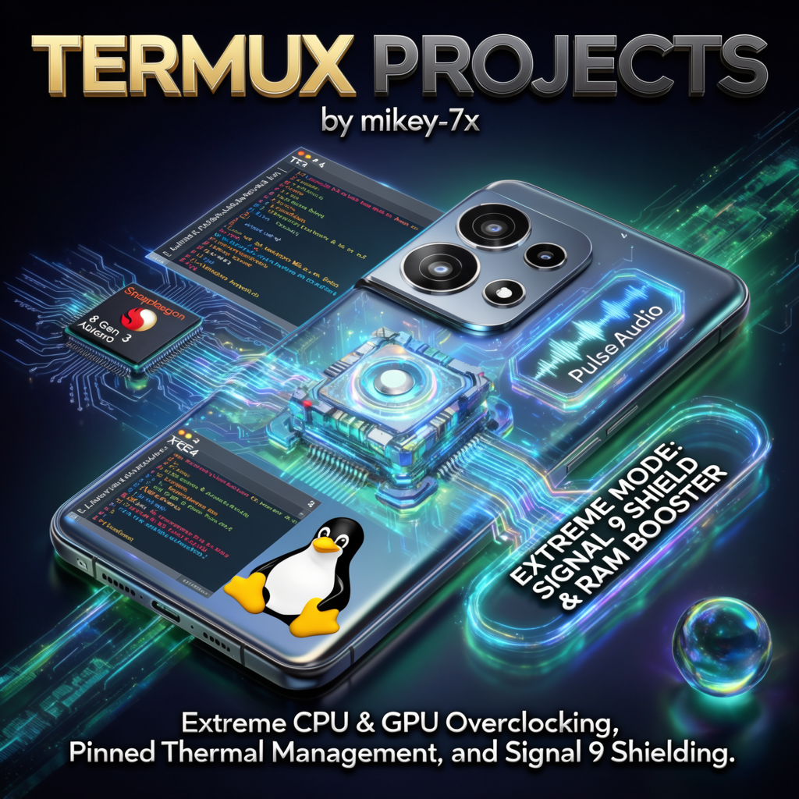

# 🐧 Termux Projects

<p align="center">
  
</p>

> A collection of practical Termux utilities for Android — full desktop environments,
> Android↔Linux storage bridging, process tools, and optional Android tuning scripts.
> The OnePlus 13R software-update screen supplied by the maintainer shows ColorOS 17
> build `CPH2691_17.0.0.105(EX01C10P02)` as up to date. Script behavior remains build-
> and workload-dependent; no RAM or stability result is guaranteed.

[](LICENSE)
[]()
[]()
[]()

**Maintainer:** [mikey-7x](https://github.com/mikey-7x) ·
**Repository:** [mikey-7x/Termux-projects](https://github.com/mikey-7x/Termux-projects)

---

## 📑 Contents

| # | Section | What it does |
|---|---------|--------------|
| 1 | [Project 1 — XFCE4 desktop](#-project-1) | Any Linux distro (udroid/proot) with XFCE4 GUI **and working sound** in Termux-X11 |
| 2 | [Project 2 — Storage bridge](#-project-2) | Full Android internal storage access from inside any distro |
| 3 | [Process kill utilities](#-process-kill-utilities) | Safe/hard ways to kill all proot processes without breaking Termux |
| 4 | [Termux Extreme Mode (`extreme_mode_safe.sh` v6)](#-termux-extreme-mode--signal-9--phantom-process-fix) | ColorOS 17-targeted Termux permissions and process-policy settings; some DeviceConfig flags may be blocked by the OS |
| 5 | [Ultra RAM Booster (`xs7_ramclear.sh` v6)](#-ultra-ram-booster--app-cache-purge-xs7_ramclearsh) | Attempts cache cleanup and app/process restrictions; available RAM varies and no fixed amount is promised |
| 6 | [ColorOS 17 Debloater (`debloat_13r_safe.sh` v6)](#coloros-17-debloater) | Optional package-update removal, app-data clearing, and user-0 package disabling; review the list and side effects first |
| 7 | [Remove built-in Virtualization Terminal](#remove-virtualization-terminal) | Optional package removal for builds that include `com.android.virtualization.terminal` |
| 8 | [Deep Termux & Arch PRoot ROM Cleaner (`rom_cleaner_termux.sh`)](#-deep-termux--arch-linux-proot-rom-cleaner-rom_cleaner_termuxsh) | Reclaims 15–40+ GB of hidden caches, `.backup-*` Wine prefixes, and staging archives safely |
| 9 | [Arch Linux mirrors](#-working-arch-linux-mirrors-in-termux) | Working pacman mirrorlist for proot Arch |
| 10 | [Project 3 — Void Linux desktop](#-project-3) | Ultra-light Void + XFCE + Falkon + audio |
| 11 | [License & credits](#-license--credits) | MIT |

---

## 📂 Complete Repository Script Index

| Script File | Where to Run | Purpose |
|-------------|--------------|---------|
| `p1.sh` | Termux | Launch XFCE4 desktop + PulseAudio TCP sound (UDroid / Kali NetHunter / generic distro) |
| `pd.sh` / `pd2.sh` / `pd3.sh` | Termux | Launch `proot-distro` Ubuntu XFCE4 desktop in Termux-X11 with hardware sound |
| `pd2sd.sh` | Termux | Launch `proot-distro` XFCE4 desktop with external SD card bind-mounted |
| `vd.sh` | Termux | Launch Void Linux XFCE4 desktop with AAudio PulseAudio loopback & X11 |
| `killp.sh` | Termux | Interactive safe process terminator for all Termux-owned background processes |
| `ukill.sh` / `killu.sh` | Inside PRoot Distro | Safe (`ukill.sh`) and hard (`killu.sh`) PRoot background process terminators |
| `extreme_mode_safe.sh` | aShell (Shizuku) / ADB | ColorOS 17-targeted Termux/process-policy settings; permissions and protected DeviceConfig writes are build-dependent |
| `xs7_ramclear.sh` | aShell (Shizuku) / ADB | ColorOS 17 v6 cache, process, package and background-policy actions; may clear diagnostic history and affect background notifications |
| `debloat_13r_safe.sh` | aShell (Shizuku) / ADB | ColorOS 17 v6 package list; removes app updates, clears selected app data, and disables selected packages for user 0; not risk-free |
| `rom_cleaner_termux.sh` | Termux | **Deep Container & Storage Cleaner**: Cleans Termux `apt`, Arch `pacman`, hidden `.backup-*` Wine prefixes, Wine temp files, and Arduino `staging/` archives |

---

## 🔥 Project 1

### Run Any Linux Distribution with XFCE4 in Termux-X11 GUI (with Working Sound)

This project lets you run a full desktop Linux environment (XFCE4) inside Termux on
Android with GUI and working audio using Termux-X11.

---

### Quick One-Liner to Download and Execute

```bash
curl -O https://raw.githubusercontent.com/mikey-7x/Termux-projects/main/p1.sh && chmod +x p1.sh && nano p1.sh
```

After editing the script (see Step 2 below), run:

```bash
./p1.sh
```

---

### Step-by-Step Manual Setup

**Step 1 — Install required packages**

*In Termux:*

```bash
termux-setup-storage
pkg update && pkg upgrade -y
pkg install wget -y
pkg install git -y
pkg install tur-repo -y
pkg install x11-repo -y
pkg install termux-x11-nightly -y
pkg install pulseaudio -y
pkg install curl -y
```

*In your Linux distribution (Ubuntu, Kali, etc.):*

```bash
apt update -y
apt upgrade -y
apt install sudo nano adduser -y
```

```bash
adduser your_name
```

then it will ask for a password — type it.

```bash
nano /etc/sudoers
```

then find `root ALL=(ALL:ALL) ALL` and BELOW IT TYPE:

```
YOUR_NAME ALL=(ALL:ALL) ALL
```

Ctrl+X → Y → Enter. Then switch to your user:

```bash
su - your_name
```

Run `whoami` — if it prints your user id, the user was made successfully. Then:

```bash
apt update && apt install -y xfce4 dbus-x11 xfce4-goodies xfce4-terminal x11-xserver-utils
```

> Most of the time `sudo` is not required as root; if needed, simply prefix `sudo`
> before the `apt` command.

> ⚠️ **Known issue:** this command often stops mid-installation on
> `elementary-xfce-icon-theme`. Remove that single package with:
>
> ```bash
> dpkg --remove --force-remove-reinstreq elementary-xfce-icon-theme
> ```

*For Arch Linux:*

```bash
sudo pacman -Syu --noconfirm xfce4 dbus xorg-xhost
```

or

```bash
sudo pacman -Syu --noconfirm
sudo pacman -S --needed xfce4 xfce4-goodies
```

**Step 2 — Prepare Termux**

Run in Termux and remove the `#` from the `#allow-external-apps = true` line in:

```bash
nano ~/.termux/termux.properties
```

**Step 3 — Download the script manually**

```bash
wget https://raw.githubusercontent.com/mikey-7x/Termux-projects/main/p1.sh
```

Edit the script:

```bash
nano p1.sh
```

Replace the following lines:

```
udroid login jammy:xfce4 << 'EOF'
su - yogesh -c 'export
```

**With:**

```
[your_login_command_here] << 'EOF'
su - [your_username_here] -c 'export
```

> To run as root, simply remove the `su - yogesh -c` part from the p1.sh script.

**Step 4 — Make the script executable and run it**

```bash
chmod +x p1.sh
./p1.sh
```

---

### For proot-distro distributions

**Steps 1 & 2 are the same as above.**

**🦞 Install script**

```bash
curl -O https://raw.githubusercontent.com/mikey-7x/Termux-projects/main/pd.sh
```

**OR**

```bash
curl -O https://raw.githubusercontent.com/mikey-7x/Termux-projects/main/pd2.sh
```

**🦞 Open script**

```bash
nano pd.sh
```

**OR**

```bash
nano pd2.sh
```

Replace `ubuntu` with your linux distribution's login id in this line of the script:

```
ubuntu <<'EOL'
```

**For the pd2.sh script:** replace `proot-distro login ubuntu` with your login id,
and replace `ubuntu` with your user id in this line:

```
proot-distro login ubuntu --shared-tmp -- /bin/bash -c  'export PULSE_SERVER=127.0.0.1 && export XDG_RUNTIME_DIR=${TMPDIR} && su - ubuntu -c "env DISPLAY=:0 startxfce4"'
```

```
exit 0
```

**🦞 Give permission**

```bash
chmod +x pd.sh
```

**OR**

```bash
chmod +x pd2.sh
```

**🦞 Execute the script**

```bash
./pd.sh
```

**OR**

```bash
./pd2.sh
```

---

### For Kali-Nethunter (rootless)

All procedures are the same as above (process Steps 1, 2, 3, 4), plus these extra
steps to set up Kali-Nethunter with XFCE4 in the Termux-X11 GUI.

The `p1.sh` script works perfectly with Kali-Nethunter, **with sound**.

**🦞 In Termux run:**

```sh
nano $PREFIX/bin/nh
```

**🦞 Find the `/dev` line and, after this line, add:**

```sh
-b /data/data/com.termux/files/usr/tmp:/tmp \
```

Then press `Ctrl+X` → `Enter`.

**🦞 After everything is done, run Kali-Nethunter with GUI:**

```sh
./p1.sh
```

---

### 💥 New: external SD card access (`pd2sd.sh`)

A new script, **`pd2sd.sh`**, gives your Linux distro access to an external SD card.

Simply copy your SD card path and replace `/storage/67FE-7DD2:` with your path in
this line of the script:

```
--bind /storage/67FE-7DD2:/mnt/sdcard_ext \
```

> **Note:** when editing the script to put your login id, make sure you use the
> **original login command** (e.g. `proot-distro login ubuntu`), not an alias — and
> then add your user id.
>
> In all scripts here, `pd2sd.sh` is designed to work well with proot-distro
> distributions. The first script, `p1.sh`, works directly with an alias or any
> login id.

---

## 🔥 Project 2

### Access internal storage in any Linux distribution in Termux on Android

**Step 1:** Make a shortcut for your login id in Termux:

```bash
nano ~/.bashrc
```

add:

```bash
alias mikey="udroid login jammy:xfce4 su mikey"

# Enable colored prompt
force_color_prompt=yes

if [ -n "$force_color_prompt" ]; then
    if [ -x /usr/bin/tput ] && tput setaf 1 >&/dev/null; then
        PS1='\033[01;32m\u@\h:\w\$ \033[00m'
    else
        PS1='\u@\h:\w\$ '
    fi
fi

if [ ! -d ~/storage ]; then
    mkdir -p ~/storage
    ln -s /storage/emulated/0 ~/storage/shared
    ln -s /storage/emulated/0/Download ~/storage/downloads
    ln -s /storage/emulated/0/DCIM ~/storage/dcim
    ln -s /storage/emulated/0/Movies ~/storage/movies
    ln -s /storage/emulated/0/Music ~/storage/music
    ln -s /storage/emulated/0/Pictures ~/storage/pictures
else
    [ ! -e ~/storage/shared ] && ln -s /storage/emulated/0 ~/storage/shared
    [ ! -e ~/storage/downloads ] && ln -s /storage/emulated/0/Download ~/storage/downloads
    [ ! -e ~/storage/dcim ] && ln -s /storage/emulated/0/DCIM ~/storage/dcim
    [ ! -e ~/storage/movies ] && ln -s /storage/emulated/0/Movies ~/storage/movies
    [ ! -e ~/storage/music ] && ln -s /storage/emulated/0/Music ~/storage/music
    [ ! -e ~/storage/pictures ] && ln -s /storage/emulated/0/Pictures ~/storage/pictures
fi

[ -d /home/mikey ] && cd /home/mikey
```

*For Arch Linux:*

```bash
alias mikey='proot-distro login archlinux --user mikey'
mkdir -p ~/storage

ln -sf /data/data/com.termux/files/home/storage/shared    ~/storage/shared
ln -sf /data/data/com.termux/files/home/storage/downloads ~/storage/downloads
ln -sf /data/data/com.termux/files/home/storage/dcim      ~/storage/dcim
ln -sf /data/data/com.termux/files/home/storage/music     ~/storage/music
ln -sf /data/data/com.termux/files/home/storage/movies    ~/storage/movies
ln -sf /data/data/com.termux/files/home/storage/pictures  ~/storage/pictures
```

**Edit:**

1. In the first line
   (`alias mikey="udroid login jammy:xfce4 su mikey"` /
   `alias mikey='proot-distro login archlinux --user mikey'`):

   - 🔗 the word `mikey` after `alias` is the shortcut you type to log in — change
     it to whatever you like.
   - 🔗 replace `udroid login jammy:xfce4` or `proot-distro login archlinux` with
     your root login command.
   - 🔗 replace `mikey` in `su mikey` or `--user mikey` with your user login id.

2. In the last line (`cd /home/mikey`):
   - 🔗 replace `/home/mikey` with your default path for your user login id.

**Step 2:** press `Ctrl+X` → `Y` → `Enter`

**Step 3:** run this in Termux:

```bash
source ~/.bashrc
```

**Step 4:** run your distribution by typing the alias (from step 1) in Termux —
in my case it is:

```bash
mikey
```

**Step 5:** create the accessible storage links:

```bash
mkdir -p ~/storage

ln -sf /data/data/com.termux/files/home/storage/shared    ~/storage/shared
ln -sf /data/data/com.termux/files/home/storage/downloads ~/storage/downloads
ln -sf /data/data/com.termux/files/home/storage/dcim      ~/storage/dcim
ln -sf /data/data/com.termux/files/home/storage/music     ~/storage/music
ln -sf /data/data/com.termux/files/home/storage/movies    ~/storage/movies
ln -sf /data/data/com.termux/files/home/storage/pictures  ~/storage/pictures
```

For an even simpler setup:

```bash
rm -rf ~/storage  # remove the whole folder safely
ln -sf /data/data/com.termux/files/home/storage/shared ~/storage
```

**Now you can access all of Android's internal storage from inside your Linux
distribution in Termux.**

> **Note:** you can choose any alias for logging in — I use the same name as my
> login id (`mikey` in my case).

---

## 🔥 Process kill utilities

### Kill all Termux processes safely (no harm to other packages/files)

```bash
wget https://raw.githubusercontent.com/mikey-7x/Termux-projects/refs/heads/main/killp.sh
```

### Kill processes running inside Ubuntu

*safe:*

```bash
wget https://raw.githubusercontent.com/mikey-7x/Termux-projects/refs/heads/main/ukill.sh
```

*hard:*

```bash
wget https://raw.githubusercontent.com/mikey-7x/Termux-projects/refs/heads/main/killu.sh
```

---

## 🔥 Termux Extreme Mode — Signal 9 & Phantom Process Fix

`extreme_mode_safe.sh` v6 targets the OnePlus 13R running ColorOS 17. The supplied
Software update screenshot shows build `CPH2691_17.0.0.105(EX01C10P02)` and says
“Version up to date.” This confirms the installed build shown in the screenshot; it
does not by itself verify that every script command is accepted by that build.

### What the v6 script attempts

- Set phantom-process and cached-app/freezer configuration values.
- Apply ColorOS app-preload settings and keep Termux, Termux:X11 and related Termux
  packages out of Doze restrictions.
- Grant requested Termux permissions and AppOps where Android permits them.
- Restrict background activity for selected apps, including Facebook, Drive and Gmail.

### aShell / ColorOS compatibility note

On this OnePlus 13R, earlier aShell output showed Android rejecting protected
`DeviceConfig` flags with `SecurityException: ... must add flag to the allowlist`.
The current v6 script still attempts several related keys, including
`cur_max_cached_processes`, `max_empty_time_millis` and
`content_provider_retain_time`. ColorOS may reject those writes. The script redirects
many command errors, so a final “OK” line or a quiet run is not proof that every
setting took effect. Do not treat the script as a guaranteed zero-cache switch or a
fix for every Signal 9 event.

App restrictions can delay notifications, sync, alarms or background work. The
script's list and effects should be reviewed before use; it is not a per-app-only
setting. Android and ColorOS continue to manage cached processes and memory.

### Download and run

Download in Termux, then run from aShell with Shizuku authorization:

```bash
curl -fsSL https://raw.githubusercontent.com/mikey-7x/Termux-projects/main/extreme_mode_safe.sh -o /storage/emulated/0/extreme_mode_safe.sh
```

```sh
sh /storage/emulated/0/extreme_mode_safe.sh
```

Measure `/proc/meminfo` `MemAvailable` before and after the same workload to assess
the effect. Do not use `MemFree` or a one-time “RAM freed” value as a guaranteed
baseline. No fixed RAM amount or zero-SIGKILL result is promised.

---

## ⚡ Ultra RAM Booster & App Cache Purge (`xs7_ramclear.sh`)

The ColorOS 17 v6 version of `xs7_ramclear.sh` performs broad cache, process and
background-policy actions. It is optional and can affect other apps, not just
Facebook, Drive and Gmail.

### What the v6 script attempts

- Trim package caches and clear selected Android log, process-statistics,
  battery-statistics and exit-info records. This removes diagnostic history; it is
  not a way to gain a lasting amount of RAM.
- Apply cached-process, app-preload and freezer configuration values. Some
  `DeviceConfig` keys may be rejected by ColorOS; errors are redirected by the script.
- Disable selected system/telemetry packages and Drive components; restrict or
  force-stop selected background apps; trim/kill processes where Android allows it.
- Preserve Termux-related packages listed in the script. Other background apps may
  lose timely notifications or sync. The broad third-party restrictions can affect
  WhatsApp delivery; test notification behavior rather than assuming an exemption.

The script does **not** guarantee 6 GB `MemAvailable`, and processes may be restarted
by Android or ColorOS. Check `MemAvailable` in `/proc/meminfo` under the workload you
actually use. A cached process appearing in a list does not by itself prove active
CPU or network use.

### Download and run

Download in Termux, then run from aShell with Shizuku authorization:

```bash
curl -fsSL https://raw.githubusercontent.com/mikey-7x/Termux-projects/main/xs7_ramclear.sh -o /storage/emulated/0/xs7_ramclear.sh
```

```sh
sh /storage/emulated/0/xs7_ramclear.sh
```

Review the package and AppOps lists before running. Do not run it while relying on
background notifications, uploads or long-running tasks unless you have tested those
functions afterward.

---

<a id="coloros-17-debloater"></a>

## 🛡️ OnePlus 13R ColorOS 17 Debloater (`debloat_13r_safe.sh`)

The v6 script targets the OnePlus 13R / ColorOS 17 package list. It checks for
listed packages, then attempts to remove their system-app updates, clear their app
data, and disable them for Android user 0. These actions are not equivalent to
clearing only cache: `pm clear` deletes the selected package's stored data, while
removing updates or disabling a package can change features and integrations.

The script's keep list includes the Gemini app package
`com.google.android.apps.bard`, but its disable list includes
`com.google.android.aicore`. Keeping the Gemini app installed does not guarantee all
on-device AI features remain available if AICore is disabled.

### Important limitations

- The script redirects command errors and increments its count when a package is
  found, not only when every operation succeeds. Its final count is not a verified
  success count.
- Review the package list and save any data you need before running it. Do not run
  it solely to increase `MemAvailable`; disabling packages does not guarantee a
  particular RAM result.
- If a feature you rely on stops working, identify the specific disabled package
  before restoring it. Avoid blindly enabling or disabling unrelated system apps.

### Download and run

Download in Termux, then run from aShell with Shizuku authorization:

```bash
curl -fsSL https://raw.githubusercontent.com/mikey-7x/Termux-projects/main/debloat_13r_safe.sh -o /storage/emulated/0/debloat_13r_safe.sh
```

```sh
sh /storage/emulated/0/debloat_13r_safe.sh
```

---

<a id="remove-virtualization-terminal"></a>

## 🧩 Removing Built-in Android 16/17 Virtualization Terminal (Optional)

On Android builds where package `com.android.virtualization.terminal` is present,
these commands remove it for user 0. This is separate from Termux and is optional.
Run in aShell with Shizuku authorization or in an ADB shell. First confirm the
package exists:

```sh
pm path com.android.virtualization.terminal
```

Then run the requested commands:

```sh
am force-stop com.android.virtualization.terminal; pm clear com.android.virtualization.terminal; pm disable-user --user 0 com.android.virtualization.terminal; pm uninstall -k --user 0 com.android.virtualization.terminal
```

`pm clear` permanently deletes that app's local data. Removing the package for user
0 may affect Android's built-in virtualization Terminal feature; it does not remove
Termux. Availability and command results depend on the installed system build.

---

## 🧹 Deep Termux & Arch Linux PRoot ROM Cleaner (`rom_cleaner_termux.sh`)

Android's built-in storage cleaner cannot see inside `/data/data/com.termux/files/`. Over time, Termux and Arch Linux (`mpd` / `proot-distro`) accumulate tens of gigabytes of hidden package caches, `.backup-*` Wine prefixes, and staging archives.

### What `rom_cleaner_termux.sh` Safely Cleans (Without Touching Working Engines or Projects):
1. **Termux APT & Arch Linux Pacman Package Caches** (`/var/cache/pacman/pkg/*`)
2. **Hidden `.backup-*` Wine Prefixes** (`~/.xs-7-prefixes/.backup-*`, keeping active working prefixes 100% intact)
3. **Wine Temporary Folders & Old `xs-7` Run Logs** (`drive_c/users/*/Temp/*`, `run-*.log`, `prefix-*.log`)
4. **Arduino CLI / IDE Downloaded Staging Archives** (`~/.arduino15/staging/*` and `.arduino-data/staging/*`, keeping all installed boards & toolchains intact)
5. **Leftover `/tmp` Build Artifacts & `.FileManagerRecycler` Trash**

### Run Directly in Termux:

```bash
bash rom_cleaner_termux.sh
```

**Verified Storage Recovery on OnePlus 13R (256 GB ROM):**
- **Before:** `184 GiB` used / `37 GiB` available (`84%` full)
- **After:** **`147 GiB` used / `72 GiB` available (`67%` full — ~40 GB freed!)**

---

## 🦞 Working Arch Linux mirrors in Termux

```bash
echo 'Server = http://mirrors.tuna.tsinghua.edu.cn/archlinuxarm/$arch/$repo' > /etc/pacman.d/mirrorlist
```

OR

```bash
nano /etc/pacman.d/mirrorlist
```

```
Server = http://mirror.archlinuxarm.org/$arch/$repo
```

---

## 🔥 Project 3

# 🐧 Void Linux Desktop on Android
### Termux • proot-distro • XFCE • X11 • Working Audio

> **Author:** mikey-7x
> **Platform:** Android (No Root)
> **Status:** Stable Desktop + Browser + Audio

---

### 📌 Overview

This project provides a **complete Linux desktop environment on Android** using:

- **Void Linux** (ultra-light, fast, systemd-free)
- **Termux + proot-distro**
- **XFCE Desktop**
- **Termux-X11 real display server**
- **PulseAudio with real Android sound output**

This is **not** VNC, not emulation, not a fake desktop — it is a real Linux system
running inside Android.

---

### ✨ Features

| Feature | Status |
|---------|--------|
| Void Linux Shell | ✅ Working |
| XFCE Desktop | ✅ Working |
| Hardware Audio | ✅ Working |
| Termux-X11 Display | ✅ Working |
| Falkon Browser + YouTube | ✅ Working |
| Package Manager (xbps) | ✅ Working |
| Non-Root Installation | ✅ Supported |
| Long Sessions Stability | ✅ Protected with Termux Extreme Mode |

---

### 🧠 Why Void Linux?

Void Linux is ideal for Android because:

- No **systemd** (avoids proot conflicts)
- Very low memory usage
- Extremely fast package manager (`xbps`)
- Minimal background services
- Perfect compatibility with Termux environments

---

### 🧰 Requirements

- Android 10+
- **Termux** from F-Droid
- **Termux-X11** app
- Minimum **4 GB RAM** recommended
- No root required

---

### 🏗 Installation

**1️⃣ Prepare Termux**

```bash
pkg update -y
pkg install -y root-repo x11-repo
pkg install -y proot-distro termux-x11 pulseaudio dbus
```

**2️⃣ Install Void Linux**

```bash
proot-distro install void
```

**3️⃣ Enter Void Linux**

```bash
proot-distro login void
```

**4️⃣ Install Desktop & Tools (inside Void)**

```bash
xbps-install -Syu

xbps-install -y \
  xfce4 xfce4-terminal \
  xorg-minimal xrandr \
  mesa-dri \
  dbus-x11 \
  noto-fonts-ttf dejavu-fonts-ttf liberation-fonts-ttf \
  fontconfig glibc-locales \
  pulseaudio pulseaudio-utils \
  falkon dillo
```

**Configure locale:**

```bash
echo "en_US.UTF-8 UTF-8" >> /etc/default/libc-locales
xbps-reconfigure -f glibc-locales

echo 'export LANG=en_US.UTF-8' >> /etc/profile
echo 'export LC_ALL=en_US.UTF-8' >> /etc/profile
```

**Exit Void:**

```bash
exit
```

---

### 🌐 Installing & Configuring Falkon Browser (Void Linux)

> These steps are done **inside Void Linux**.

**1️⃣ Install Falkon**

```bash
xbps-install -y falkon qt5-wayland qt5-x11extras
```

(Those Qt packages prevent crashes and rendering issues.)

**2️⃣ Create a safe launcher**

Falkon cannot run as root unless its sandbox is disabled. This wrapper makes
Falkon stable on Android:

```bash
nano /usr/local/bin/falkon-safe
```

Paste:

```bash
#!/bin/sh
export QTWEBENGINE_DISABLE_SANDBOX=1
export QT_XCB_GL_INTEGRATION=none
falkon "$@"
```

Save and exit. Make executable:

```bash
chmod +x /usr/local/bin/falkon-safe
```

**3️⃣ Run Falkon**

```bash
falkon-safe
```

**🧪 Optional: Desktop menu entry**

```bash
nano /usr/share/applications/falkon-safe.desktop
```

Paste:

```ini
[Desktop Entry]
Name=Falkon (Safe)
Exec=/usr/local/bin/falkon-safe
Icon=falkon
Type=Application
Categories=Network;WebBrowser;
```

Update the menu:

```bash
update-desktop-database
```

Falkon now appears in the XFCE menu as **Falkon (Safe)**.

**🧠 Why this works:**

| Setting | Reason |
|---------|--------|
| Disable sandbox | Required because proot runs as root |
| Disable Qt GL | Prevents GPU crashes on Android |
| Qt X11 packages | Prevents blank window / crashes |

**🟢 Result:** Falkon launches reliably, YouTube works, audio works, no sandbox
crash, maximum stability on Android.

---

### 🖥 GUI + Audio startup script

Create the launcher in Termux:

```bash
wget https://raw.githubusercontent.com/mikey-7x/Termux-projects/refs/heads/main/vd.sh
chmod +x vd.sh
```

**🚀 Launch desktop**

```bash
./vd.sh
```

Then open the Termux-X11 app.

**🌐 Browsers**

- Main browser: `falkon --no-sandbox`
- Backup lightweight browser: `dillo`

**🔊 Audio architecture**

```
Void Linux → PulseAudio TCP → Termux PulseAudio → Android AAudio → Speaker
```

This gives real hardware sound inside the Linux desktop.

---

### ⚠️ Known limitation

Android may kill heavy apps with SIGKILL (signal 9) when memory is low. This is a
kernel memory-management behavior. The Extreme Mode and RAM scripts can alter some
process/background policies, but cannot prevent every low-memory kill or guarantee a
fixed amount of available RAM.)

---

### 🏁 Final result

You now have a real Linux desktop environment on Android with:

- GUI
- Browser
- Hardware audio
- Package manager
- Development tools
- RAM availability and process survival depend on the device workload; no fixed amount or zero-kill guarantee

**No root. No VNC. No emulation.**

---

## 📜 License & Credits

This project is licensed under the
[MIT License](LICENSE).
You are free to use, modify, and distribute with proper attribution.

Developed by **[mikey-7x](https://github.com/mikey-7x)** 🚀🔥

Built & maintained by mikey-7x — community-grade Linux on mobile.

[Other repositories](https://github.com/mikey-7x?tab=repositories)

Thanks to the developers of Termux, Termux-X11, PulseAudio, XFCE4, UDroid, Shizuku, aShell, and the
open-source Linux community.
